# CYSE 211 — Lab 1: Linux System and Filesystem Exploration

  

Explored **Linux command-line fundamentals, system documentation, kernel log access, filesystem navigation, storage partitioning, UUIDs, and inode metadata** in an Ubuntu virtual machine. This lab records 12 terminal exercises, including successful inspections and encountered permission or command-availability errors.

**Original lab report:** [View the seven-page PDF](docs/CYSE211_Lab1_Report.pdf)

## At a glance

| Item | Details |
|---|---|
| Course | CYSE 211 — Operating Systems |
| Platform | Ubuntu Linux in a virtual machine |
| Focus | Shell commands, filesystem inspection, kernel logs, storage, and metadata |
| Commands examined | pwd, man, dmesg, runlevel, cd, ls, parted, blkid |
| Evidence | 12 screenshots from the submitted lab report |
| Observed storage | 21.5 GB virtual NVMe disk; EFI/FAT32 and ext4 partitions |

## Assessment Workflow

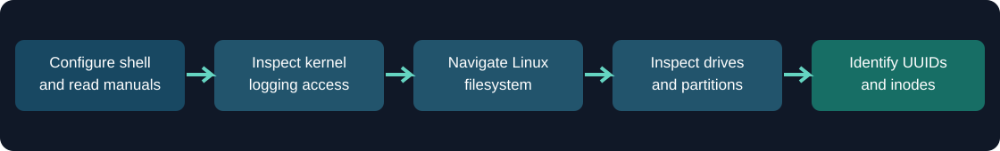

## Evidence Screenshots

All **12 terminal screenshots** from the submitted report appear below in report order, including the observed errors.

**01. Custom terminal prompt**

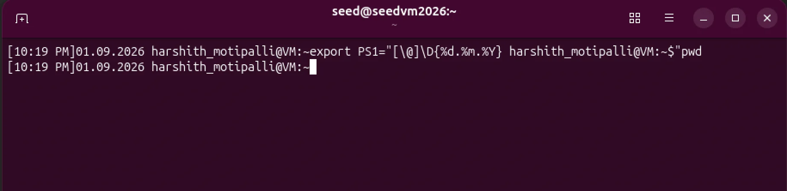

*Configured a timestamped shell prompt and attempted to display the working directory.*

**02. Linux manual page: man pwd**

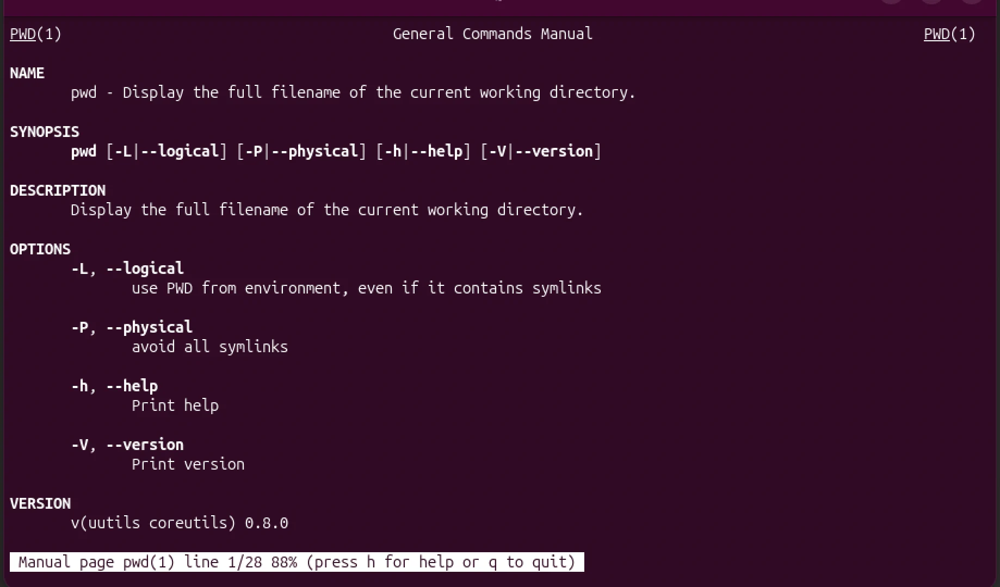

*Reviewed the documented syntax and options of pwd.*

**03. Kernel log viewer: dmesg | less**

*Opened the pager; the screenshot shows its end, rather than readable kernel messages.*

**04. Recent kernel messages: dmesg | tail**

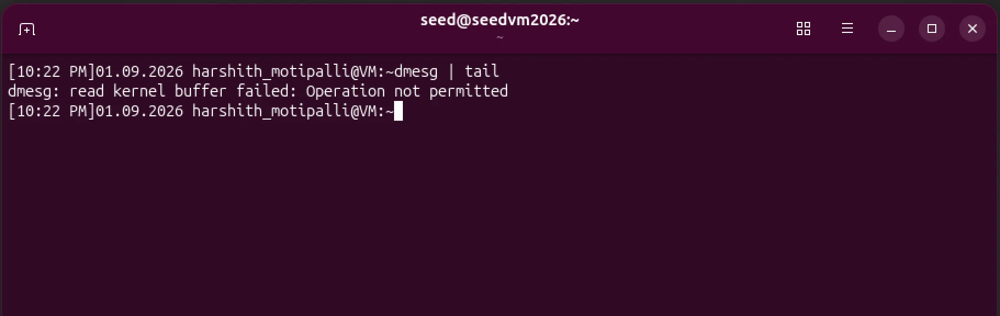

*The kernel ring buffer could not be read: Operation not permitted.*

**05. Early kernel messages: dmesg | head**

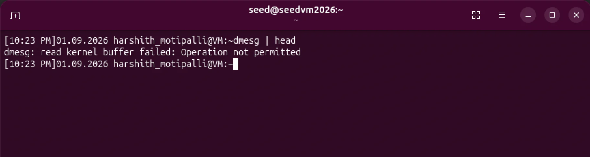

*The same insufficient-permissions error occurred for the first entries.*

**06. System run level: runlevel**

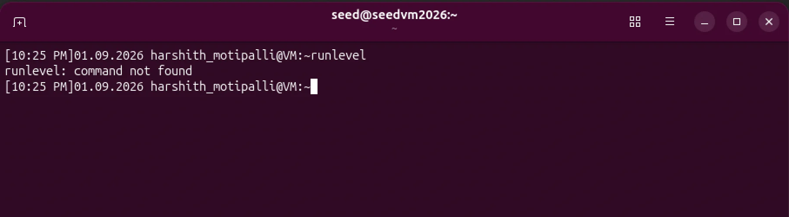

*The command returned command not found in this environment.*

**07. Move to filesystem root: cd /**

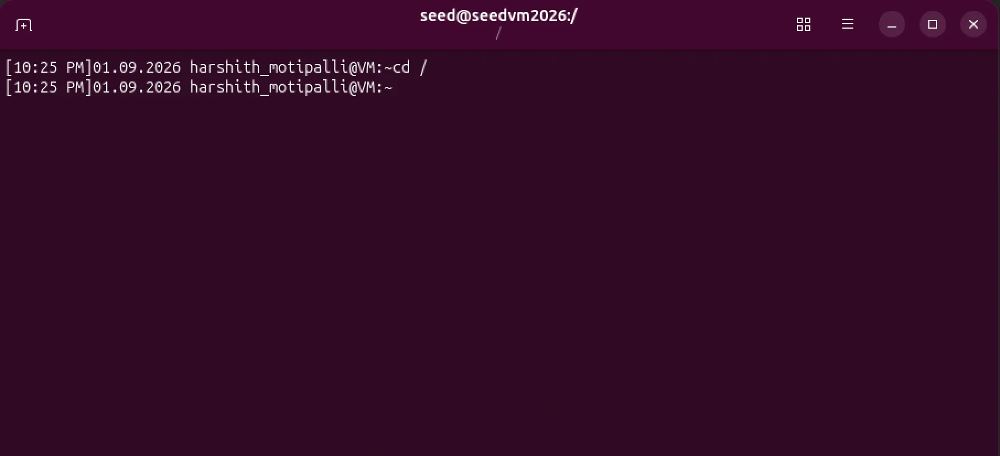

*Changed the working directory to the root of the Linux filesystem.*

**08. Confirm directory: pwd**

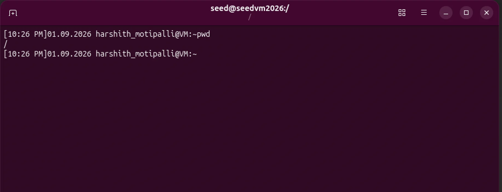

*Verified the current working directory as / .*

**09. Long directory listing: ls -l**

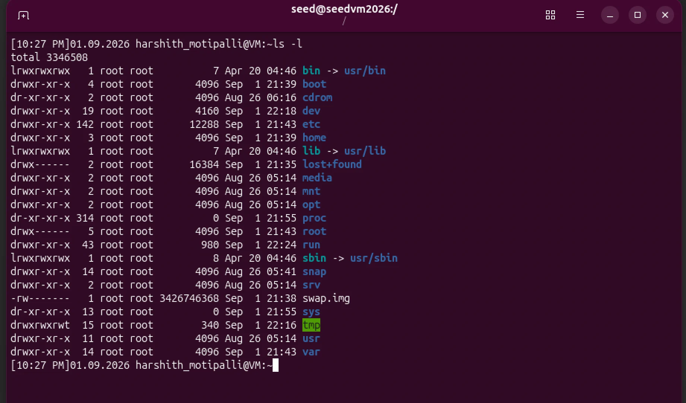

*Inspected permissions, owners, sizes and timestamps within / .*

**10. Partition overview: sudo parted -l**

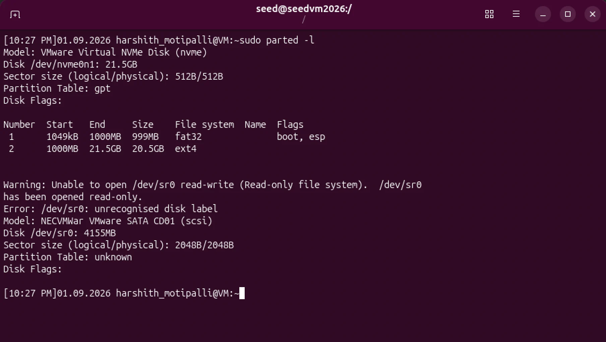

*Inspected a 21.5 GB virtual NVMe disk with EFI/FAT32 and ext4 partitions; the optical drive reported a read-only warning.*

**11. Block device metadata: sudo blkid**

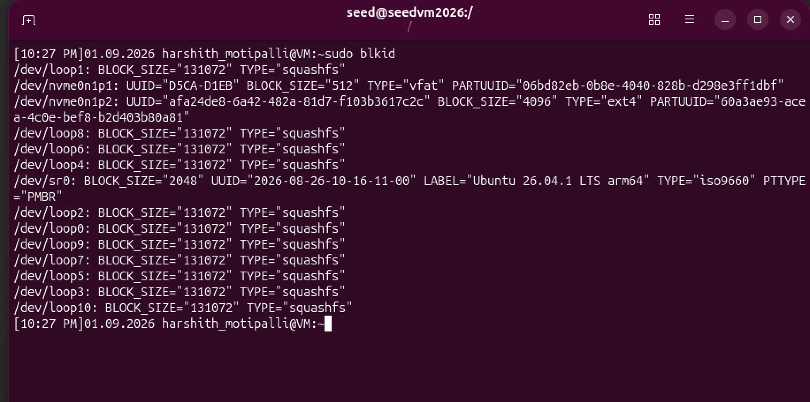

*Displayed block-device UUIDs, filesystems and device identifiers.*

**12. Filesystem inode listing: ls -i**

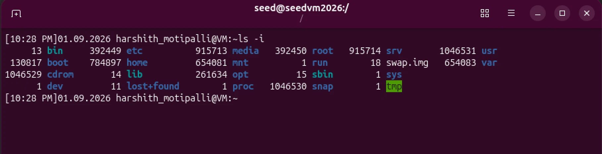

*Displayed inode numbers for root-directory entries.*

## Findings and Evidence

| Area | Observation |
|---|---|
| Shell and documentation | Practiced prompt customization, directory display, and local command manuals. |
| Kernel logs | dmesg with head and tail returned Operation not permitted for the unprivileged shell. |
| System runlevel | runlevel returned command not found; no runlevel value was established. |
| Directory navigation | cd / followed by pwd confirmed the root directory. |
| File attributes | ls -l displayed permissions, owners, sizes, and modification times. |
| Storage layout | sudo parted -l showed a 21.5 GB VMware NVMe disk with a 999 MB FAT32 EFI partition and a 20.5 GB ext4 partition. |
| Block identifiers | sudo blkid displayed UUID and filesystem type fields. |
| Inodes | ls -i displayed inode numbers for the root-directory entries. |

## What This Project Demonstrates

- Practical use of the Linux shell and system manuals.
- Identification of permission limitations when inspecting kernel logs.
- Understanding of the Linux root directory and filesystem metadata.
- Inspection of virtual disk partitions, filesystem types, and UUIDs.
- Recognition of inode numbers and their relationships to directory entries.
